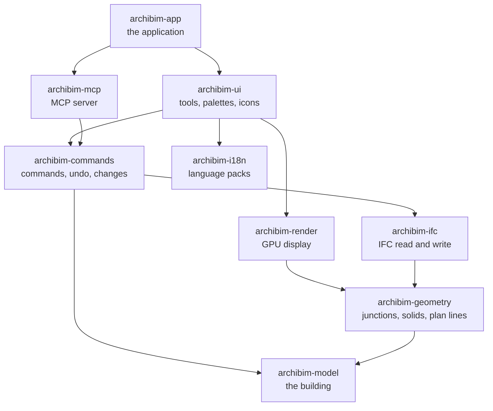
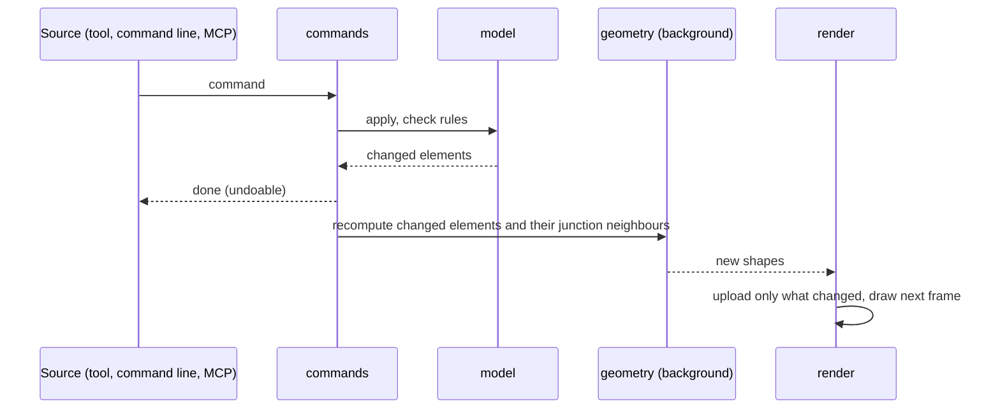

# Architecture

How OPEN-ARCHIBIM is built, and the rules that keep it clean and fast. The
reasons behind each choice are in [docs/decisions](docs/decisions/README.md).

This is the target architecture. No code exists yet: the Stage 0 prototype
builds its first slice and may adjust it, through a new decision record.

---

## Goals, in order

1. **Correct.** The model behaves as architects expect: the test cases in
   [tests/cases](tests/cases/README.md) pass.
2. **Fluid.** The interface never freezes, and navigation stays smooth on an
   ordinary laptop (see "Performance budget").
3. **Clean.** Each part has one job and clear boundaries, so that the code
   stays easy to read, test and replace.
4. **Open.** Libraries sit behind our own interfaces and can be swapped. Every
   dependency is listed in [PROVENANCE.md](PROVENANCE.md).

---

## Language

**Rust** ([ADR 0001](docs/decisions/0001-rust.md)), in a single Cargo
workspace.

---

## Layers

The workspace is split into crates. Each crate depends only on the crates
below it. The compiler enforces these boundaries, so they cannot be crossed
by accident ([ADR 0002](docs/decisions/0002-layered-workspace.md)).



| Crate | Job | Must not |
|---|---|---|
| `archibim-model` | The building as data: project, stories, elements and their parts, materials and junction priorities, renovation status, types and instances. Checks its own rules. | Depend on any other crate of the workspace, read files, draw. |
| `archibim-geometry` | Derives shapes from the model: wall layers and junctions, solids, plan linework, hatches. Pure functions. Wraps geometry libraries behind our own types. | Keep state, draw, know about the interface. |
| `archibim-commands` | Every change to the model is a command: apply, undo, redo, and the list of elements it changed. Saving and opening go through it. | Know about the interface or the MCP protocol. |
| `archibim-ifc` | Reads and writes IFC files (STEP text), maps IFC to our model and back. | Hold application state. |
| `archibim-i18n` | Loads language packs, gives text by key, formats numbers and units. | Contain user-facing text in code. |
| `archibim-render` | Draws plan and 3D on the GPU, keeps shapes in GPU memory, chooses the level of detail. | Change the model. |
| `archibim-ui` | Windows, tools, palettes, command line, icons. Turns user gestures into commands. | Change the model except through commands. |
| `archibim-mcp` | Exposes commands to AI agents and scripts through MCP. | Bypass commands. |
| `archibim-app` | Assembles the crates into the application. | Contain logic of its own. |

Crate names may change in the prototype; the layering does not.

---

## The flow of a change

Every change follows the same path, whoever makes it: a tool in the
interface, the command line, a script or an AI through MCP.



- **One path, one undo.** Nothing changes the model outside a command.
- **Only what changed is recomputed.** A command returns the elements it
  touched. Geometry recomputes them and their neighbours in the junction
  graph, never the whole project.
- **The interface never waits.** Geometry runs on background threads; the
  interface keeps drawing the previous shapes until the new ones are ready.
- **Stable identities.** Every element has a permanent identifier, which is
  also its IFC GlobalId.

---

## Performance budget

Fluidity is measured, not hoped for
([ADR 0003](docs/decisions/0003-gpu-incremental-rendering.md)).

| Measure | Target |
|---|---|
| Navigation (pan, zoom, orbit) in plan and 3D | 60 frames per second (16.7 ms per frame) |
| A command on one element, visible on screen | under 100 ms |
| Opening the reference project | under 3 s |

- **Reference project**: a housing block of about ten stories, defined
  during the prototype and kept in the repository.
- **Reference machine**: an ordinary laptop with an integrated GPU.
- **Benchmarks run in CI.** A change that breaks the budget is visible in the
  pull request.

How we hold the budget:

- plan and 3D both drawn on the GPU (`wgpu`);
- shapes kept in GPU memory and replaced only when they change;
- repeated elements (identical windows, furniture) drawn once and repeated
  by the GPU;
- level of detail by scale: no window profiles at 1:500;
- only what is on screen is drawn;
- heavy work on background threads, never on the interface thread.

---

## Quality rules

These rules are checked by the CI as soon as code exists.

- **Formatting**: `rustfmt`, checked.
- **Lints**: `clippy` with no warning allowed. In library crates, no
  `unwrap()` or `expect()`: errors are typed and returned.
- **No `unsafe` code**, except in `archibim-render` where the GPU needs it,
  each block justified by a comment.
- **Tests**: every crate has its own; `agreed` test cases become automated
  tests.
- **Dependencies**: `cargo-deny` checks licenses (MIT-compatible only, as in
  PROVENANCE.md) and known security advisories. A new dependency needs a
  reason in its pull request.
- **Toolchain** pinned in `rust-toolchain.toml`, so that everyone builds with
  the same compiler.
- **Public items documented.**

### Technical debt

- Debt is written down, never hidden: an issue with the `tech-debt` label,
  and a `TODO(#issue)` comment that points to it.
- At the end of every stage, a debt review decides what is paid back before
  the next stage starts.
- Every structural choice gets a decision record in
  [docs/decisions](docs/decisions/README.md). Changing it means writing a
  new record, not editing the old one.

---

## Interface and symbols

The interface stays simple and clear: few tools, simple monochrome
pictograms, a command line always available.

- **Our own icon catalogue**
  ([ADR 0004](docs/decisions/0004-own-icon-catalogue.md)), drawn as each tool
  is built: SVG on a 24 × 24 grid, one stroke weight, single colour that
  follows the theme. Never copied or traced from another product.
- **Drawing symbols** (a door swing in plan, a window in elevation) follow
  drawing conventions and are catalogued the same way.

```
assets/
  icons/      interface pictograms, one per tool or action
  symbols/    drawing symbols for plans, sections and elevations
```

---

## Repository layout

```
crates/            the Rust workspace (one folder per crate above)
assets/            icons and drawing symbols
lang/              language packs
tests/cases/       architect test cases (YAML)
tests/projects/    reference projects for tests and benchmarks
docs/decisions/    architecture decision records
```

The folders appear when their first content does.
