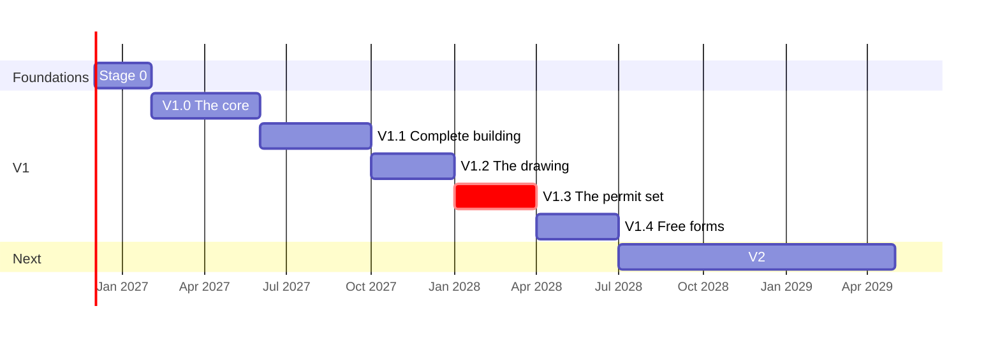

# OPEN-ARCHIBIM Roadmap

Every stage ends with **something an architect can try**. The scope of each
stage comes from the tool review in [TOOLS.md](TOOLS.md), sections 3 and 4.

Guiding principles: see [MANIFESTO.md](MANIFESTO.md).

---

## At a glance

| Stage | What you can do at the end | Tools | Duration | Indicative window |
|---|---|---|---|---|
| **0. Foundations** | Watch a prototype video, read the project, contribute | — | 2 months | Dec 2026 → Jan 2027 |
| **V1.0 The core** | Draw a simple house in plan and 3D, exchange it as IFC | 39 | 4 months | Feb → May 2027 |
| **V1.1 The complete building** | Roof, stairs, railings, furniture, terrain, rooms, renovation | 14 | 4 months | Jun → Sep 2027 |
| **V1.2 The drawing** | Plans, sections and elevations legible without retouching | 30 | 3 months | Oct → Dec 2027 |
| **V1.3 The permit set** | Submit a real building permit application, published as PDF and DWG | 21 | 3 months | Jan → Mar 2028 |
| **V1.4 Free forms** | Warped roofs, sculpted volumes, curtain walls | 5 | 3 months | Apr → Jun 2028 |
| **V2** | Coordination with project partners, rendering, details, revisions | 25 | 9 to 12 months | mid-2028 → 2029 |
| **V3** | Several people on one project, MEP, structure, energy | 13 | to be defined | from 2029 |

**Key milestone: March 2028.** This is the first version a studio can use to
produce a building permit application from start to finish (V1.0 to V1.3,
about 15 months after the start).

---

## The team behind these durations

The durations assume a **core team**:

- **2 full-time developers**, assisted by AI;
- **1 half-time architect**, who settles design questions and tests each
  stage.

They change a lot with resources and with the technical choice:

| Situation | Effect on V1 (V1.0 → V1.4) |
|---|---|
| Core team, our own kernel (options A or B) | ≈ 19 months, as above |
| Core team, building on `bimcraft-core` (option D) | ≈ 13 to 15 months: walls, views, sheets and IFC already exist |
| A single developer | × 2 to × 3: 3 to 4 years |
| 4 developers or more | ≈ 12 months at best: coordination limits the gain |

These are orders of magnitude. They will be revised at the end of each stage
by comparing actual time with planned time.

---

## Stage 0 — Foundations *(Dec 2026 → Jan 2027)*

Goal: a readable, credible project, and a settled technical choice.

- [x] MIT license
- [x] Manifesto
- [x] Tool review: [TOOLS.md](TOOLS.md) (findings, design rules, review of
      162 tools, V1 stages)
- [ ] **Two-week prototype** on options D and B (see below), then the
      technical decision
- [ ] **Needs map**: for each tool family, a sheet written **in our own
      words** (the need, today's problem, what we drop), fed by real studio
      cases
- [ ] `PROVENANCE.md`: where each engine comes from (public specification,
      reused code and its license)
- [ ] `CONTRIBUTING.md`: clean-room rule, "concrete gap" issue template,
      review by an architect of every design feature, translation guide
- [ ] 10 architects interviewed about their three biggest frustrations
- [ ] Prototype video, launch of the funding page

**Deliverable:** a documented public repository, the technical decision, and
a first call for contributors and funding.

## V1.0 — The core *(4 months)*

A simple house (without a roof) drawn in plan and 3D, saved and read back as
IFC. This is also where the foundations of everything else are laid:

- stories, grids, composite walls with **junctions driven by material
  priority**, slabs, doors, windows, openings, columns, beams;
- **linked types and instances**, one single material definition;
- **synchronised windows** for plan and 3D;
- **command line** and **MCP server**: every action is a command;
- **native IFC**, saving;
- **translation from day one**: no text is hard-coded. English and French
  ship with V1.0.

**Deliverable:** the house, read back without errors by other IFC tools.

## V1.1 — The complete building *(4 months)*

A redesigned roof (any reference plane, overhang set edge by edge,
independent layers), stairs (helical with no angle limit), railings, objects
and furniture, terrain, rooms and areas, and **layer-based renovation**
(external insulation added onto the existing wall).

**Deliverable:** first trials in 2 or 3 pilot studios, on one real new-build
project and one renovation.

## V1.2 — The drawing *(3 months)*

One view style, named line weights, fonts by purpose, hatches, dimensions,
texts and labels, sections and elevations, reference overlay, multi-selection
eyedropper.

**Deliverable:** plans, sections and elevations of a house, ready to print
without retouching.

## V1.3 — The permit set *(3 months)*

Layouts, title blocks, PDF and DWG publishing, schedules, area tables,
properties and classifications, other partners' models as references.
Spanish, Italian, German and Portuguese language packs complete the first
six languages.

**Deliverable: the first usable version.** A real building permit application
submitted by a pilot studio, produced entirely in OPEN-ARCHIBIM.

## V1.4 — Free forms *(3 months)*

Non-planar roofs, free-form volumes and Boolean operations, curtain walls,
drawn profiles.

## V2 *(9 to 12 months)*

Issue management (BCF), clash detection, model comparison, linked modules,
revisions, details, automatic dimensioning, interior elevations, rendering,
sun studies…: the 25 V2 tools in [TOOLS.md](TOOLS.md).

## V3 *(from 2029)*

Several people working on the same project at once, MEP, structure, energy,
point clouds, Rhino…: the 13 V3 tools.

---

## Technical decision to make

| Option | For | Against |
|---|---|---|
| **A. Rust application (egui/wgpu) + our own IFC kernel** | Full control, performance, a single code base | The longest: the whole geometry and IFC kernel to write |
| **B. Build on IfcOpenShell (C++/Python)** | Mature, proven IFC kernel, geometry available | Interface and ergonomics entirely to build; mixed languages |
| **C. Contribute to Bonsai (Blender + IfcOpenShell)** | Existing ecosystem, active community | Ergonomics tied to Blender, which is not designed for architects |
| **D. Build on `bimcraft-core` (BIMCraft, Rust, MIT/Apache)** | UI-less Rust core, already rich: wall junctions, plans, sections, sheets, PDF, schedules, IFC; compatible license | Data model shaped after Revit (families, view templates); very young project, very fast code pace, one main maintainer |

**Provisional recommendation: test D and B in parallel.** We should not
rewrite what already exists under an open license. The effort belongs where
something is truly missing: the studio way of working and 2D drawing. The
two-week prototype of Stage 0 must answer one question: can we put
**stories**, **composite walls with junction priorities** and **renovation
status** on top of this core without bending it? If yes, D. If not, B.

## Related projects

| Project | What it is | What we take from it |
|---|---|---|
| [BIMCraft](https://github.com/IPedrax/BIMCraft) | Open take on the Revit workflow, in Rust (MIT/Apache-2.0), drivable by agents (MCP) | Its UI-less core is reusable (option D). Its "every action is a command" architecture gives undo, scripting and tests for free. |
| [BimCraft (CadCraft)](https://github.com/getcadcraft/bimcraft) | Web BIM application in JavaScript (Apache-2.0), by a company; the names are trademarks | Its `PROVENANCE.md` is the model to follow: each engine states which public specification it comes from, and GPL tools are only used as test oracles. |
| [Bonsai / IfcOpenShell](https://ifcopenshell.org) | Reference open-source IFC kernel | The oracle that validates our IFC files, whatever the technical choice. |

We learn from them and reuse their code when the license allows it, keeping
their notices (`NOTICE`). We take neither their names nor their Revit-shaped
logic.

---

## Funding

- **Claude for Open Source** (6 months of Claude Max for maintainers): apply
  once the repository has visibility, at the end of Stage 0 with the
  prototype video, or at the latest when V1.0 ships.
- **Open Collective / GitHub Sponsors**: transparent funding, public
  spending.
- **Partners**: pilot studios, architecture schools, professional bodies.

Each funded stage is announced with its budget and its deliverable.
